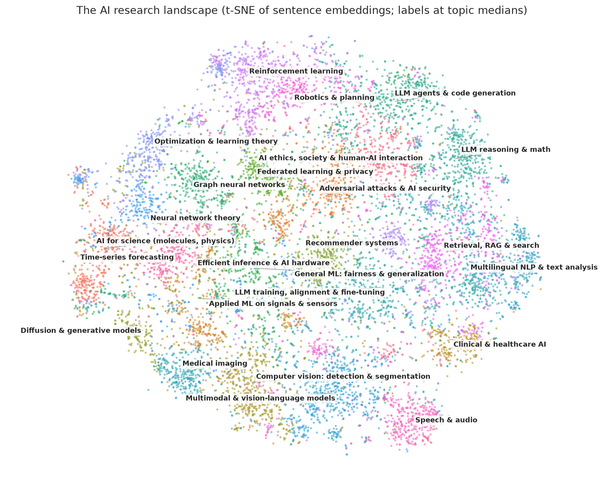
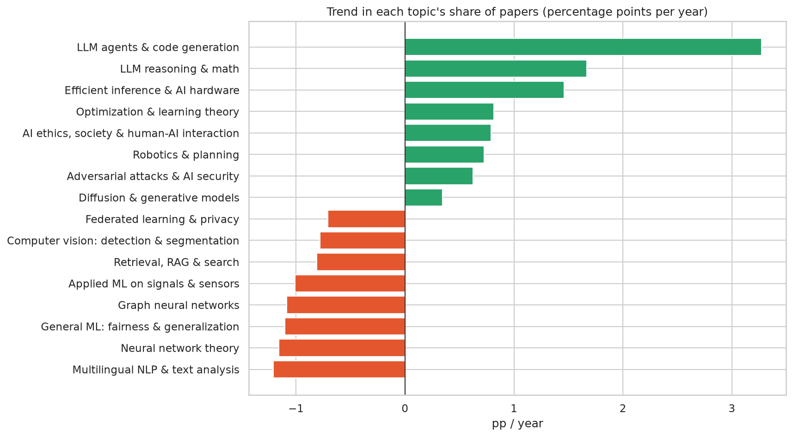
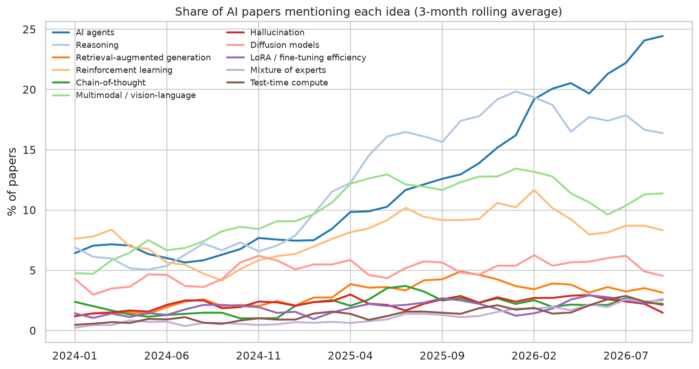

# 🛰️ AI Research Radar

**Mapping 12,060 AI research papers with sentence embeddings: automatic topic discovery, trend detection and a semantic search app.**


> 🌐 **[Live interactive dashboard](https://anascs12.github.io/ai-research-radar/)** · 📓 **[Analysis notebook](notebooks/ai_research_radar.ipynb)** · 🔎 **Semantic search app:** `uv run streamlit run app/streamlit_app.py`



## Why this project
Thousands of AI papers appear on arXiv every month, so nobody can read them all. Embeddings turn text into vectors that capture **meaning**, which makes it possible to group, track and search research by idea rather than by exact words. The same retrieval step powers **semantic search and RAG** systems.

## Key findings (January 2024 – September 2026)

| | Finding |
|---|---|
| 🤖 | **LLM agents are the breakout topic.** Their share of papers grew **4.6×** (2.1% → 9.8%), accelerating from mid-2025. By the end of the period, **~23% of AI papers mention agents**, up from 6.6%. |
| 🧠 | **Reasoning** papers doubled their share (3.2% → 6.1%), and mentions of reasoning **tripled** (5.7% → 16.9%). |
| ⚡ | **Efficient inference & AI hardware** (quantization, KV cache, serving) grew 2.5×. Mixture-of-experts mentions grew 3.7× and test-time compute 2.9×, consistent with the cost of running reasoning models. |
| 📉 | Falling shares: **graph neural networks** (4.3% → 1.8%), **federated learning** (3.0% → 1.1%) and classic multilingual NLP (7.1% → 4.4%). |
| 🔎 | For three everyday-language queries, **keyword search found 0 papers**, while semantic search returned relevant ones, including the honest limits of a small embedding model (see the notebook). |

<p>


</p>

## How it works

```
arXiv API ──▶ 12,060 papers (cs.CL / cs.LG / cs.AI), 60 per 5-day window, cached
   │
   ▼  title + abstract
all-MiniLM-L6-v2 sentence embeddings (384-d, CPU, normalised)
   │
   ├─▶ k-means (k = 25) ──▶ class-based TF-IDF keywords ──▶ hand-checked topic names
   ├─▶ monthly topic shares ──▶ trend slopes (pp/year) and early-vs-late change
   ├─▶ regex keyword trends (agents, reasoning, RAG, MoE, …)
   ├─▶ t-SNE 2-D map ──▶ Plotly dashboard (GitHub Pages)
   └─▶ cosine similarity ──▶ Streamlit semantic search (vs. keyword baseline)
```

**Design decisions worth discussing**
- **Time-stratified sampling:** a fixed number of papers per 5-day window makes **topic shares** comparable over time. The flip side is that the counts don't reflect arXiv's true volume, which is stated as a limitation.
- **Choosing k honestly:** silhouette scores were low and nearly flat (0.055–0.059 for k = 15–35), which is normal for overlapping research topics. k = 25 was chosen because every topic stayed coherent when I read its keywords and sample titles.
- **Class-based TF-IDF** (the BERTopic idea) labels each topic with words that are frequent in it but rare elsewhere. A unit test caught a subtle bug: `min_df` on one-document-per-topic input discards exactly the distinctive words.
- **Topic share vs. mentions:** the RAG topic's *share* fell while papers *mentioning* RAG doubled. Retrieval appears to be becoming a component inside agent systems; this is flagged as an interpretation, not a proven cause.

## Semantic search app

```bash
uv run streamlit run app/streamlit_app.py
```

Type a question in plain English, filter by topic and month, and optionally compare against keyword search side by side. Results link to the papers on arXiv.

## Run it yourself
Requires [uv](https://docs.astral.sh/uv/). Processed data and embeddings are included, so the app and notebook work right after cloning.

```bash
git clone https://github.com/anascs12/ai-research-radar.git
cd ai-research-radar
uv sync
uv run streamlit run app/streamlit_app.py          # semantic search
uv run jupyter lab notebooks/                       # analysis
uv run --group dev pytest                           # 8 offline tests

# Rebuild everything from scratch (about 40 min: arXiv's API asks for 3 s between requests)
uv run python -m radar.arxiv       # download
uv run python -m radar.pipeline    # embeddings, topics, map
```

## Project structure
```
├── src/radar/
│   ├── arxiv.py       # polite, cached arXiv API client and stratified sampler
│   ├── nlp.py         # embeddings, k-means, c-TF-IDF, trends, semantic + keyword search
│   ├── pipeline.py    # end-to-end run: embeddings → topics → t-SNE map
│   └── dashboard.py   # Plotly dashboard for GitHub Pages
├── app/streamlit_app.py
├── notebooks/ai_research_radar.ipynb
├── scripts/           # notebook generator and the written findings
├── data/              # processed papers, embeddings, topic names
├── docs/index.html    # the live dashboard
└── tests/
```

## Limitations
- A sample, not a census: within each window the earliest submissions are over-represented.
- Only papers in cs.CL, cs.LG or cs.AI are included.
- Each paper gets exactly one topic, although many span several.
- Topic names are my interpretation; keyword trends use simple regular expressions.
- `all-MiniLM-L6-v2` is small. A larger embedding model, hybrid search or a re-ranker would improve retrieval.

## Credits
Paper metadata from the [arXiv API](https://info.arxiv.org/help/api/index.html). Thank you to arXiv for use of its open access interoperability. Embeddings by [sentence-transformers](https://www.sbert.net/).

Code: MIT licence. Built by **[Anas Khan](https://www.linkedin.com/in/anas-khan-ds/)**, Data Science student at IMSciences Peshawar.
